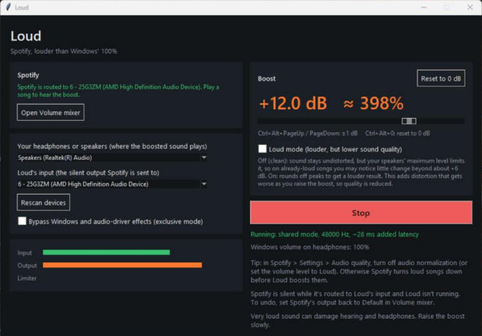

# Loud

A small Windows utility that answers one question: **"why is Spotify still too quiet, with every volume slider already at 100 %?"**

Windows stops at 100 %. Loud boosts Spotify by up to +24 dB past that, runs the result through a limiter so it does not clip, and plays it on your speakers or headphones next to everything else. Games, Discord and your browser keep their own volume, because only Spotify is sent through Loud.

It is written in Python (tkinter and NumPy, WASAPI through `ctypes`) and ships as one `Loud.exe`. There is nothing to run in the background: it is a window, and when you close it, it is gone.



## What it does

**Boost.** A slider from -24 to +24 dB (+6 dB is about twice as loud, +12 dB about four times). Click the bar to jump, drag the handle to fine-tune. It fades in over 1.5 seconds every time Loud starts, so nothing ever jumps to full level. Hotkeys work from any window: `Ctrl+Alt+PageUp` and `Ctrl+Alt+PageDown` change it by 1 dB, `Ctrl+Alt+0` resets it to 0 dB.

**Limiter.** A look-ahead peak limiter holds the sound at -0.3 dBFS, so extra boost does not turn into crackling. The **Limiter** meter shows how much it is working.

**Loud mode (optional, off by default).** Rounds off peaks before the limiter. That gets more volume out of songs that are already loud, at a real cost: the sound is distorted, more so the higher the boost. See [Clean mode and Loud mode](#clean-mode-and-loud-mode).

**Spotify check.** The Spotify panel reads which device Spotify is playing to and tells you in plain words if it is not going to Loud, with the fix.

**Meters and Windows volume.** Input, Output and Limiter meters, and a note (with a one-click fix) if the Windows volume of your speakers is below 100 %, which would cap the result.

**Devices.** Your speakers or headphones (where the boosted sound plays) and Loud's input (the silent output Spotify is sent to). If the PC has only one sound output, Loud says so and links to the free VB-Cable (see [Set up](#set-up-once)).

**Exclusive mode (optional).** Plays through the device in WASAPI exclusive mode, which skips Windows and driver effects such as Equalizer APO or Realtek processing. It takes over the device, so every other app is silent on it while Loud runs. Off by default.

**Start with Windows (optional, installed copy only).** One checkbox.

## How it works

Windows can send each app to a different output, but it cannot make one app louder than 100 %. So Loud sits in the middle:

```
Spotify --(Windows per-app routing)--> a silent output --loopback--> Loud
Loud:   gain (up to +24 dB) -> [Loud mode] -> look-ahead limiter (-0.3 dBFS) -> your speakers or headphones
Other apps -----------------------------------------------------------------> your speakers or headphones
```

Loud listens to the silent output with WASAPI loopback, boosts that audio, and plays it into your real output in shared mode, so it mixes with whatever else is playing. It adds about 28 ms of delay: fine for music, not for lip-syncing video.

## Install

You need Windows 10 or Windows 11, 64-bit, and Spotify for Windows. Loud is developed and tested on Windows 11.

1. Download the latest zip from the [Releases](../../releases) page and extract it anywhere.
2. Double-click **Install Loud.bat**. No administrator prompt appears, because nothing needs one.
3. Answer the one question in the window that opens (press Enter to accept the default), then follow [Set up](#set-up-once). Loud is in the Start menu and in Settings > Apps.

Windows SmartScreen may say "Windows protected your PC" the first time, because the program is not code-signed (a certificate costs money). Click **More info**, then **Run anyway**. The source is in this repository and the release zip is built by the workflow in `.github/workflows`, so you can check what you run or build it yourself. Next to the zip is `Loud-<version>.zip.sha256`; compare it with `Get-FileHash Loud-<version>.zip` if you want to be sure the download is the file that was published.

**What the installer does:**
1. Copies `Loud.exe` to `%LOCALAPPDATA%\Programs\Loud` (your own folder, no administrator rights) and checks the copy against the original by SHA-256. It also copies `uninstall.ps1`, the license and the third-party notices.
2. Adds a Start-menu shortcut and an entry in Settings > Apps > Installed apps.
3. Asks whether Loud should start when you sign in to Windows (a value in your own `HKCU\...\Run` key). Skip the question with `-Yes` (no) or `-StartAtLogon` (yes).
4. Starts Loud (`-NoStart` skips this).

Nothing is downloaded, nothing outside your own account is changed, and `uninstall.ps1` reverses all of it. Prefer a single file? `Loud.exe` in the zip's `app` folder runs by itself from anywhere.

## Set up (once)

Windows can only send an app's sound to an output that exists, so Loud listens on a **second, silent output**. Spotify is sent there, Loud boosts it, and plays it on your real speakers or headphones.

**If your PC has two outputs** (for example speakers plus a monitor with built-in audio): in Windows **Settings > System > Sound > Volume mixer**, set Spotify's output to the one you do not listen on (the monitor), open Loud and press **Start**. Spotify has to be playing for it to show up in the mixer.

**If your PC has only one output** (most laptops):
1. Install the free **VB-Cable** from <https://vb-audio.com/Cable/> (a virtual audio device from VB-Audio; unzip it, run `VBCABLE_Setup_x64.exe` as administrator, then restart). Loud has a "Get VB-Cable" button that opens the page. It is a separate download under its own terms and is not part of Loud.
2. Keep your real speakers or headphones as the Windows default output. Do not make the cable the default.
3. In the Volume mixer, set Spotify's output to **CABLE Input**. (Some versions of Spotify also have an output-device setting under Settings > Playback; the mixer works with all of them.)
4. Open Loud and press **Start**.

Loud picks your Windows default output as the headphones and the cable (or the other device) as its input. After the first Start it starts itself when opened; press Stop and it will not until you press Start again. Spotify is silent while it is sent to the silent output and Loud is not running; that is expected.

## Clean mode and Loud mode

| | Clean mode (default) | Loud mode |
|---|---|---|
| What it does | Boosts, then limits peaks so they never clip | Also rounds off peaks (soft saturation) before the limiter |
| Quality | Undistorted | **Reduced.** Adds distortion that grows with the boost |
| Loudness | Stops growing once the loudest parts reach the maximum level. On already-loud songs you may notice little beyond about +6 dB; quieter, more dynamic songs gain more | Keeps getting louder as you raise the boost, because peaks are squashed |

Why clean mode has a ceiling: speakers and headphones have a maximum level, and many songs already reach it with the Windows volume at 100 %. A clean limiter cannot add loudness past that, only squash peaks. Measured on a generated test signal (not on real songs), Loud mode was about 2 dB louder than clean mode at +24 dB; on synthetic noise shaped like a loud master it was up to 9 to 12 dB. Real songs will vary. Keep Loud mode at roughly +12 dB or less if you care how it sounds.

## Tips

- In Spotify > Settings > Audio quality, turn **audio normalization off** (or set the volume level to Loud). Otherwise Spotify turns loud songs down before Loud boosts them.
- Leave Spotify's **Exclusive Mode** off. It takes over the device and blocks Loud from hearing it.
- Keep the Windows volume on your speakers at 100 %.
- If the Limiter bar is nearly full while playing, you have reached the ceiling and more boost will not help in clean mode.
- If the volume drifts back down after a moment, try **Bypass Windows and audio-driver effects (exclusive mode)**.
- Very loud sound can damage your hearing and your speakers. Raise the boost slowly.

## Privacy

- **No telemetry, no accounts, no update checks, no analytics.** Loud has no network code and never uploads anything. The only thing it can open on the internet is the VB-Cable page in your browser, when you press that button.
- It records one small settings file and a log, both in `%APPDATA%\Loud` on your PC. Nothing else is stored. The audio itself is processed in memory and is never written to disk.
- The installer downloads nothing.

## Settings

Everything is in the window; the file behind it is `%APPDATA%\Loud\settings.json`, rewritten when you press Start or Stop or change Loud mode:

```json
{
  "source": "{0.0.0.00000000}.{...}",
  "output": "{0.0.0.00000000}.{...}",
  "exclusive": false,
  "loud_mode": false,
  "autostart": true
}
```

`source` and `output` are Windows device ids, `exclusive` and `loud_mode` are the two checkboxes, and `autostart` makes Loud start itself when opened (it is cleared when you press Stop). The log is `loud.log` next to it. Delete the folder to reset everything.

## Uninstall

Open Settings > Apps > Installed apps > Loud > Uninstall, or run `uninstall.ps1` from the install folder (or the extracted zip). It closes Loud, removes the program folder, the shortcut, the Apps entry and the start-with-Windows value, and asks whether to delete your settings and log (`-KeepData` keeps them, `-Yes` deletes them without asking). It refuses a folder that does not contain `Loud.exe`, a drive root, and a top-level folder. It does not change Spotify's output: if Spotify is still sent to the silent output, set it back to **Default** in the Volume mixer.

## Build from source

You need Python 3.12 or newer on Windows.

```powershell
python -m venv .venv
.venv\Scripts\pip install -r requirements.txt
.venv\Scripts\python -m loud                          # run from source
.venv\Scripts\python -m unittest discover -s tests    # tests
.venv\Scripts\python -m loud.probe                    # list playback devices, what each supports and which apps use them; plays nothing
.\build.ps1                                           # builds dist\Loud.exe (PyInstaller)
.\tools\package.ps1 -Version 1.4.0                    # builds release\Loud-1.4.0.zip and its .sha256
.\install.ps1                                         # installs what is in .\dist
```

**Testing.** The unit tests need no audio hardware: the gain stage, the limiter and the soft clipper are tested on generated signals; the real-time loop is tested against simulated devices that run on the wall clock; device selection and the Spotify advice are tested as plain functions. The installer tests run `install.ps1` and `uninstall.ps1` for real, but only into a scratch folder with the Start-menu shortcut, the Apps entry and the start-with-Windows value switched off, and they check the refusals (drive root, a folder that is not a Loud install, nothing to install). The same tests run in CI on a hosted Windows runner. What no test covers: real Spotify audio, real speakers and a real VB-Cable; those were tried by hand.

Code layout: `loud/wasapi.py` (devices, loopback capture, output), `loud/engine.py` (real-time loop), `loud/dsp.py` (gain, soft clip, limiter), `loud/devices.py` (device selection), `loud/spotify.py` (where Spotify's sound is going), `loud/startup.py` (start with Windows), `loud/app.py` (window).

## Limits

- Windows 10 or 11, 64-bit only. It needs a second (silent) output; a PC with one output needs VB-Cable, which has had less testing than a monitor's audio as the silent output.
- It boosts whatever is sent to its input device. It is meant for Spotify, but it does not enforce that.
- Clean mode cannot go past the speakers' maximum level (see above). Loud mode can, but distorts.
- Exclusive mode makes every other app silent on the device while Loud runs.
- Spotify's own Exclusive Mode, if you turn it on, blocks Loud from hearing Spotify.
- About 28 ms of delay.
- The installed program is a PyInstaller bundle, about 24 MB, and it can take a few seconds to open the first time. Some antivirus programs distrust unsigned PyInstaller programs; the checksum and the source are there so you can check.

## For the security-minded

Loud runs as your normal user and never asks for administrator rights. The installer and uninstaller touch only your own profile (`%LOCALAPPDATA%\Programs\Loud`, the current user's Start-menu folder, and `HKCU` keys) and take those locations from Windows' own records, not from environment variables. The uninstaller will not delete a folder that does not contain `Loud.exe`, a drive root, or a top-level folder, and it only removes the start-with-Windows value if it points at the install it is removing. The release workflow has a read-only token, pins every action to a full commit hash, and only its last job can publish, uploading what the build job made. See [SECURITY.md](SECURITY.md) to report a problem.

## License

[MIT](LICENSE). Bundled libraries and their licenses are listed in [THIRD-PARTY-NOTICES.md](THIRD-PARTY-NOTICES.md). What changed in each version: [CHANGELOG.md](CHANGELOG.md).
